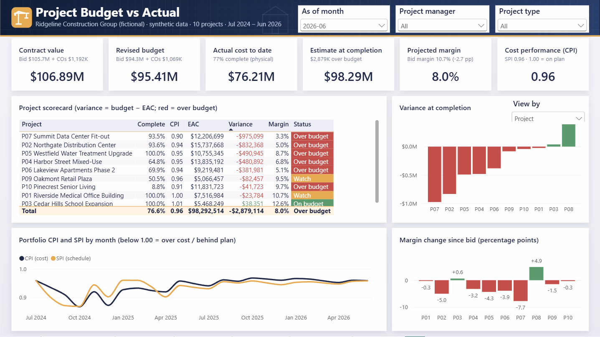
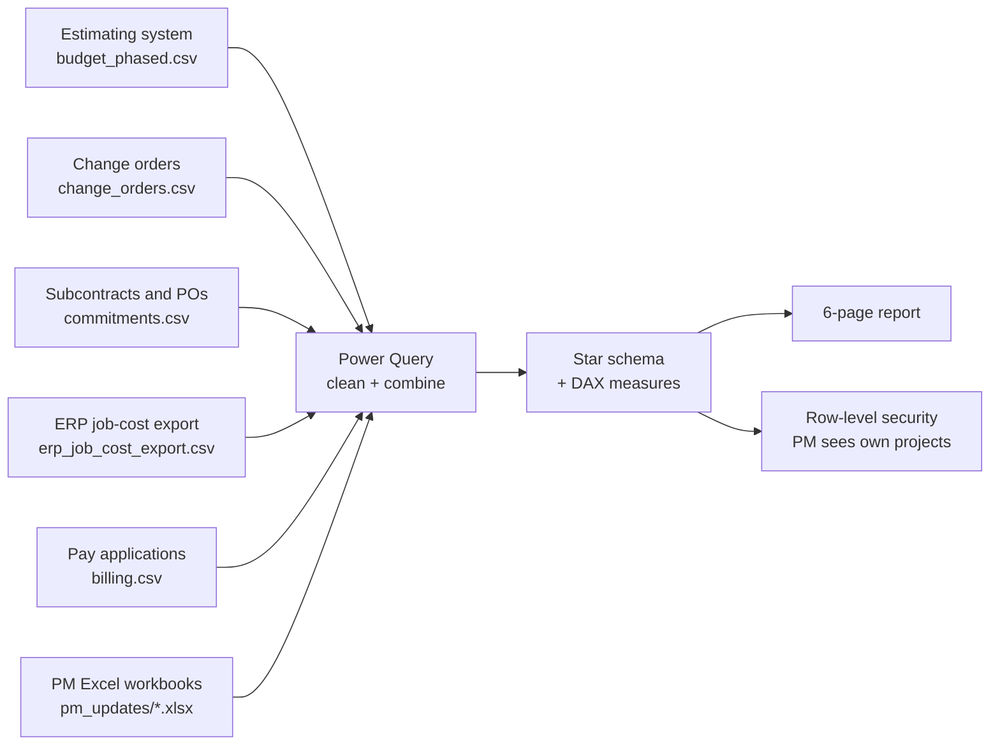
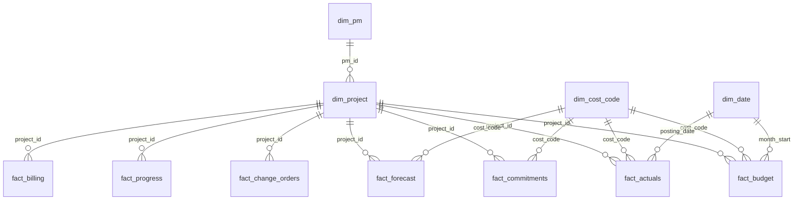
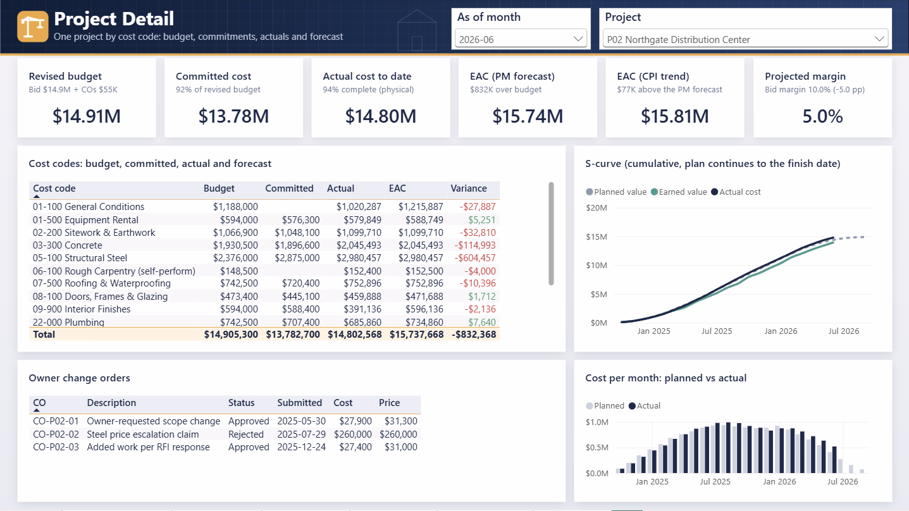
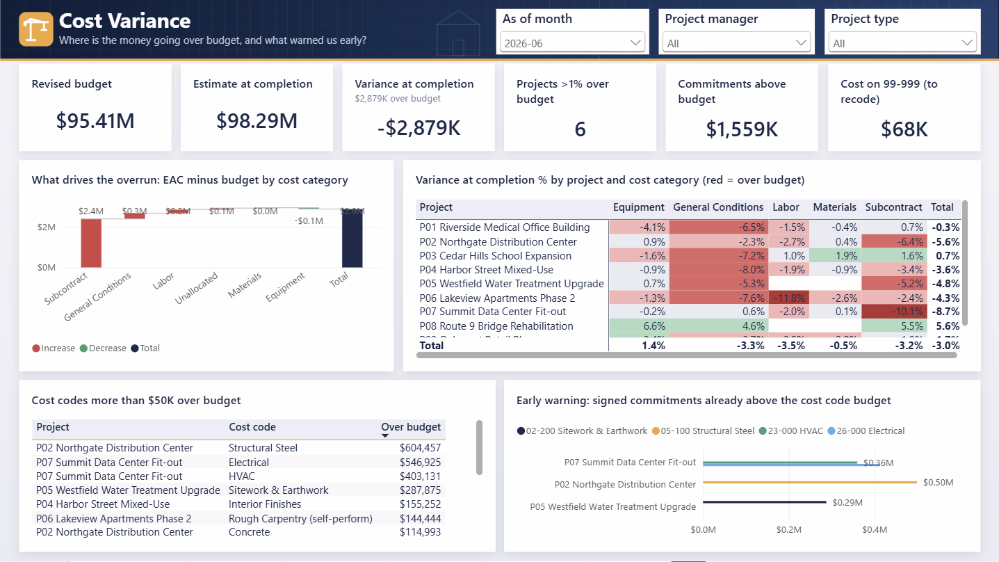
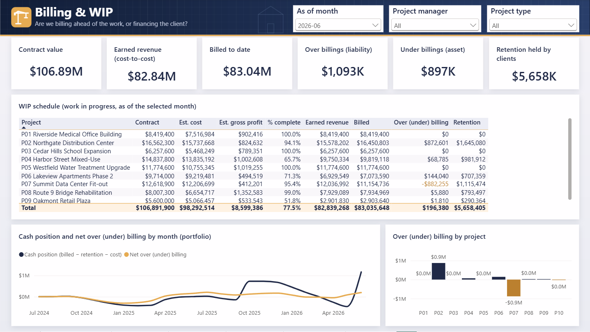
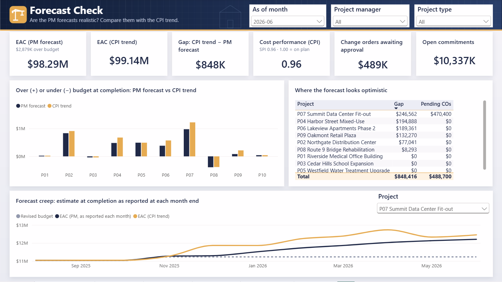
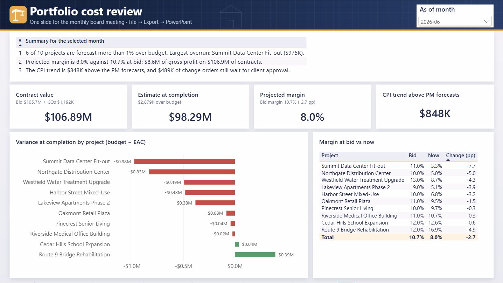

# Project Budget vs Actual Dashboard (Power BI)

A six-page Power BI report for a general contractor's project portfolio. It answers the questions a construction CFO or project controls team asks at every month-end:

- Which projects will finish over budget, and by how much?
- Where does the overrun come from, and could we have seen it earlier?
- Are we billing ahead of the work, or financing the client?
- Can we trust the project managers' forecasts?

> **Data:** fully synthetic but realistic. Ridgeline Construction Group (fictional) has 10 projects, 4 project managers and $106.9M of contracts, covering Jul 2024 to Jun 2026.
> The data was generated with [`scripts/generate_data.py`](scripts/generate_data.py) (fixed seed), so the dashboard can be shared publicly.
> No company data is used.



---

## Business questions and the page that answers them

| Page | Question | Main visuals |
|---|---|---|
| **1. Portfolio Overview** | Which projects are in trouble? | KPI cards, project scorecard with status, variance at completion with a *View by* switch (field parameter), CPI/SPI trend, margin change since bid |
| **2. Project Detail** | Which cost codes drive it, and what is already signed? | Cost code table (budget, committed, actual, EAC, variance), S-curve (planned value, earned value, actual cost), change orders, monthly planned vs actual |
| **3. Cost Variance** | Where does the money go, and what warned us early? | Waterfall by cost category, project × category heat map, cost codes more than $50K over budget, commitments already above budget |
| **4. Billing & WIP** | Are we over or under billed? | WIP schedule (cost-to-cost revenue), over/under billing by project, cash position trend |
| **5. Forecast Check** | Are the PM forecasts realistic? | PM forecast vs CPI-trend estimate, gap table, "forecast creep" chart (EAC as reported each month) |
| **6. Board Pack** | One slide for the board | Three-line summary written by DAX, 4 KPIs, variance by project, margin at bid vs now. Ready for *File → Export → PowerPoint* |

## Key findings in the data (as of June 2026)

1. **The portfolio is forecast $2.88M (3.0%) over budget.** EAC is $98.3M against a revised budget of $95.4M, and projected margin fell from **10.7% at bid to 8.0%**. Six of ten projects are more than 1% over budget.
2. **Subcontracts cause 83% of the overrun** ($2.39M of $2.88M). More than half of the total ($1.55M) sits in three cost codes: Northgate steel, and Summit HVAC and electrical.
3. **The signed contract showed the problem early.** The Northgate structural steel subcontract was signed in Jan 2025 at **$499K above its budget**. The project manager's forecast only rose step by step, from $14.94M (Jan 2025) to $15.74M (Jun 2026). The *Commitments above budget* visual flags this kind of risk on the day the contract is signed.
4. **Summit Data Center has the largest overrun ($975K), and its margin fell from 11.0% to 3.3%.** HVAC and electrical subcontract changes signed in Jan 2026 added $1.09M. A $470K change order for extra cooling still waits for client approval. Because that work is done but not billed, the project is **under-billed by $882K**.
5. **PM forecasts look optimistic.** On cost performance to date (CPI), estimates are **$848K higher** than the PM forecasts. The biggest gaps are Summit ($247K), Harbor Street ($195K) and Lakeview ($189K).
6. **Harbor Street is behind schedule (SPI 0.84).** General conditions are time-based, so each month of delay adds site staff and site office cost: $97K so far, plus $155K on interior finishes.
7. **Westfield Water finished $491K over budget.** Unforeseen rock led to a $380K owner change order, but it covered only part of the extra excavation: earthwork still finished $288K over budget.
8. **Route 9 Bridge is the best performer**: $392K under budget, with margin up from 12.0% to 16.9%.
9. **Northgate is over-billed by $873K.** That is a liability, because the client has paid for work not yet done.
10. **Data quality:** 15 ERP lines ($68K) are coded to `99-999 Unallocated`. The report shows them as a KPI, so they get recoded before month-end close.

## How the data flows



**Excel input from project managers.** Each PM keeps one workbook in `data/pm_updates/`. It has two tables:
- `tblProgress`: weekly physical % complete;
- `tblForecast`: monthly forecast to complete by cost code.

The workbooks have drop-down lists, input checks and a *Read me* sheet, and a blank template is included. Power Query reads **every workbook in the folder**, so a new PM means a new file and no change to the queries.

## Data cleaning in Power Query

| Source | Problem | Rows | Fix |
|---|---|---:|---|
| ERP export | The same batch was loaded twice | 16 | Kept one row per `txn_id` |
| ERP export | Cost code without the dash (`03300`) | 98 | Dash put back (`03-300`) |
| ERP export | Cost code with spaces | 58 | Trimmed |
| ERP export | Project ID in lower case (`p02`) | 31 | Upper-cased |
| ERP export | Cost code not in the cost code list | 15 | Mapped to `99-999 Unallocated` and shown as a KPI |
| ERP export | Invoices posted to the wrong cost code, then reversed and reposted | 24 | Kept: these are real journals, and the net amount ends up on the right code |
| PM workbooks | % typed as `45` instead of `45%` | 31 | Values above 1 divided by 100 |
| PM workbooks | Project ID typed by hand (`p02`, `P02 `) | 9 | Trimmed and upper-cased |
| PM workbooks | Same week entered twice | 2 | Kept the last entry (the correction) |
| PM workbooks | Blank rows left in the table | 8 | Removed |

## Data model

Star schema with one date table. All relationships are one-to-many and single direction.



| Table | Grain | Rows |
|---|---|---:|
| `fact_actuals` | one ERP job-cost transaction | 2,018 |
| `fact_budget` | project × cost code × month (original budget + change orders) | 1,165 |
| `fact_forecast` | project × cost code × month-end snapshot | 1,501 |
| `fact_progress` | project × week (physical % complete) | 610 |
| `fact_billing` | one pay application | 143 |
| `fact_commitments` | subcontract / PO line | 102 |
| `fact_change_orders` | one owner change order | 22 |
| `dim_project`, `dim_pm`, `dim_cost_code` | lookups | 10 / 4 / 15 |
| `dim_date` | DAX calculated table | 1,279 |

## KPI definitions

| KPI | Formula |
|---|---|
| Revised budget (BAC) | original budget + change orders approved by the as-of date |
| Committed cost | signed subcontracts and POs, including commitment changes |
| Earned value (EV) | PM's physical % complete × revised budget |
| CPI / SPI | EV ÷ actual cost / EV ÷ planned value |
| EAC (PM forecast) | actual cost to date + PM forecast to complete (latest month-end snapshot) |
| EAC (CPI trend) | actual cost + (budget − EV) ÷ CPI. Used only after 20% complete, when CPI is stable |
| Variance at completion | revised budget − EAC (negative = over budget) |
| Projected margin | (revised contract − EAC) ÷ revised contract |
| % complete (cost-to-cost) | actual cost ÷ EAC, the usual revenue method for construction contracts |
| Over (under) billing | billed to date − earned revenue (over = liability, under = asset) |
| Open commitments | committed − invoiced, per project and cost code, never below zero |

**One "as of" slicer drives the whole report.** Every to-date measure adds up everything up to the end of the selected month. On a chart with months on the axis, each month gets its own as-of date. So the same measures show the S-curve, the CPI trend and how the forecast changed month by month.

All measures are in [`powerbi/measures.md`](powerbi/measures.md), and the Power Query steps are in [`powerbi/power_query.m`](powerbi/power_query.m).

## Row-level security

| Role | Filter | Who |
|---|---|---|
| **Project Manager** | `dim_pm[pm_email] = USERPRINCIPALNAME()` | each PM sees only their own projects |
| **Executive** | none | the whole portfolio |

The filter flows from `dim_pm` to `dim_project` and on to every fact table, so one rule secures the whole model.

To test it in Power BI Desktop, use **Modeling → View as → Project Manager + Other user**, for example `david.chen@ridgeline.example`. That user sees only P02, P06 and P10.

## Techniques used

- **Power Query:**
  - combines a folder of Excel workbooks (tables, not sheet ranges);
  - cleans text and codes;
  - de-duplicates on the business key;
  - maps unknown codes to an "unallocated" code instead of dropping rows;
  - uses fixed-decimal currency types.
- **DAX:**
  - an as-of pattern (`REMOVEFILTERS` + date cut-off);
  - earned value (EV, CPI, SPI);
  - the latest snapshot per project (`SUMX` over projects with `MAX` of the snapshot date);
  - two independent EAC methods;
  - cost-to-cost revenue recognition and a WIP schedule;
  - early-warning measures over a project × cost code `CROSSJOIN`;
  - dynamic text for the board summary.
- **Model:**
  - star schema;
  - row-level security;
  - a field parameter (*View by*: project, PM, project type or cost category);
  - a disconnected helper table for the board summary lines.
- **Design:**
  - a custom theme ("Ridgeline Blueprint": navy, amber, teal) with a blueprint-style header background and a crane logo (`powerbi/background.png`);
  - one KPI row per page, and every number shown against budget or bid;
  - red/green conditional formatting driven by measures;
  - a 16:9 board slide that exports to PowerPoint.

## All pages

| Project Detail | Cost Variance | Billing & WIP |
|---|---|---|
|  |  |  |

| Forecast Check | Board Pack |
|---|---|
|  |  |

## Repository

The report is saved as a **Power BI Project (`.pbip`)**. The model and every page are plain text, so changes are visible in Git.

```
Budget vs Actual Dashboard.pbip              open this in Power BI Desktop
Budget vs Actual Dashboard.SemanticModel/    model: tables, relationships, RLS roles, 68 DAX measures
Budget vs Actual Dashboard.Report/           6 report pages and the theme
data/                                        CSV exports + data/pm_updates/ (PM Excel workbooks)
scripts/generate_data.py                     rebuilds the dataset
powerbi/                                     measures.md, power_query.m, theme.json (readable copies)
screenshots/                                 report pages
```

## Open it

1. Open `Budget vs Actual Dashboard.pbip` in Power BI Desktop (2024 or later).
2. Set the data folder: **Transform data → Edit parameters → `DataFolder`** = the full path of `data\` on your PC, ending with `\`.
3. Click **Refresh**. The data loads in a few seconds.
4. To get a single file, use **File → Save as → Power BI file (.pbix)**.

Optional: `python scripts/generate_data.py` regenerates `data/` (Python 3.9+; `pip install openpyxl` for the Excel workbooks).

---
Built by Avazbek S. as a portfolio project. Power BI · DAX · Power Query · Data Modeling · Excel
